<picture><source media="(prefers-color-scheme: dark)" srcset="assets/hero-dark.svg"></picture>

<picture><source media="(prefers-color-scheme: dark)" srcset="assets/social-l-dark.svg"></picture><a href="https://discord.com/users/1014513755951996989"><picture><source media="(prefers-color-scheme: dark)" srcset="assets/social-1-dark.svg"></picture></a><picture><source media="(prefers-color-scheme: dark)" srcset="assets/social-r-dark.svg"></picture>

<picture><source media="(prefers-color-scheme: dark)" srcset="assets/about-dark.svg"></picture>

<picture><source media="(prefers-color-scheme: dark)" srcset="assets/wave-dark.svg"></picture>

<picture><source media="(prefers-color-scheme: dark)" srcset="assets/stack-dark.svg"></picture>

<a href="https://github.com/coalizzatoh/A-Fly-Concius-Brain-in-Minecraft"><picture><source media="(prefers-color-scheme: dark)" srcset="assets/project-a-fly-concius-brain-in-minecraft-dark.svg"></picture></a>&nbsp;<a href="https://github.com/coalizzatoh/GenTools"><picture><source media="(prefers-color-scheme: dark)" srcset="assets/project-gentools-dark.svg"></picture></a>

<a href="https://github.com/coalizzatoh/SuperDuperCoolWebsite"><picture><source media="(prefers-color-scheme: dark)" srcset="assets/project-superdupercoolwebsite-dark.svg"></picture></a>&nbsp;<a href="https://github.com/coalizzatoh/Calcolo-Download-File"><picture><source media="(prefers-color-scheme: dark)" srcset="assets/project-calcolo-download-file-dark.svg"></picture></a>

<picture><source media="(prefers-color-scheme: dark)" srcset="assets/stats-dark.svg"></picture>

